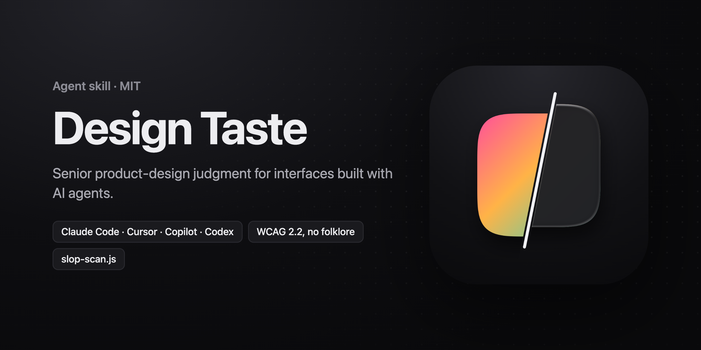

<p align="center">
  
</p>

<h3 align="center">Make AI-built UI look designed, not generated.</h3>

<p align="center">
  An agent skill that gives your coding agent a senior designer's judgment:<br />
  hierarchy, spacing, restrained colour, real content, accessible states, and no template tells.
</p>

<p align="center">
  <a href="#install"></a>
  <a href="#cursor"></a>
  <a href="#github-copilot"></a>
  <a href="#openai-codex"></a>
  <a href="skills/design-taste/references/accessibility-review.md"></a>
  <a href="#whats-new-in-20"></a>
  <a href="LICENSE"></a>
</p>

<p align="center">
  <a href="#quick-start">Quick start</a> ·
  <a href="#whats-new-in-20">What's new</a> ·
  <a href="#what-it-optimizes-for">What it does</a> ·
  <a href="#references">References</a> ·
  <a href="#install">Install</a>
</p>

## Quick start

```bash
npx skills add arez-xd/ux-ui-design-taste
```

Then ask your agent:

```text
Build the pricing page for our invoicing app. Use design-taste.
```

```text
This dashboard looks AI-generated. Review it with design-taste and fix what you find.
```

The [open skills CLI](https://github.com/vercel-labs/skills) installs into Claude Code, Codex, Cursor and other agents; per-tool setup without it is under [Install](#install).

## What this is

`design-taste` is an AI agent skill that makes generated interfaces feel intentional: clearer hierarchy, stronger spacing, better typography, more restrained color, realistic content, accessible interaction states, and fewer generic template tells.

This skill is the result of hands-on research into what actually works and what doesn't when giving AI agents design judgment. Not theoretical guidelines — principles battle-tested through real projects and iteration on AI-generated output. The patterns here are the ones that consistently move output from "looks AI-generated" to "looks considered."

It is framework-agnostic. Use it with React, Next.js, HTML/CSS, Framer code components, shadcn/ui, or any frontend surface where visual quality matters.

Building dashboards, pro tools or native iOS screens? [Design Taste Pro](https://agensi.io/r/ADAMREEL?to=/skills/design-taste-pro) is the companion skill for screens people work in all day.

---

## What's new in 2.0

- **Page slop, named and counted.** [`page-slop.md`](skills/design-taste/references/page-slop.md) lists what makes a landing or marketing page look generated — an eyebrow pill above every heading, a gradient half in the headline, every section a glowing island, the template triple, fake proof — how to find each, what to put instead, and what isn't slop.
- **[`slop-scan.js`](skills/design-taste/scripts/slop-scan.js).** Paste it into a rendered page and get the markers as JSON: accent use, uppercase and eyebrows, gradients and glows, tinted icon chips, cards inside cards, type sizes and radii. Compare before and after a change.
- **Accessibility as WCAG writes it.** 24 × 24 px targets at AA (44 × 44 for primary touch actions), 3:1 for large text and meaningful UI parts, disabled controls exempt, contrast measured on every surface. No more "44 px and 4.5:1 for everything".

---

## Install

### Claude Code (primary)

Copy the skill into your project's `.claude/skills/` directory:

```bash
cp -r skills/design-taste path/to/your-project/.claude/skills/
```

Then reference it in prompts:

```text
Use $design-taste to review and improve this component.
```

Or inject directly into your project's `CLAUDE.md` by copying the contents of `skills/design-taste/SKILL.md`.

### Cursor

Copy the Cursor rule to your project:

```bash
cp -r .cursor path/to/your-project/
```

The rule in `.cursor/rules/design-taste.mdc` will activate automatically when working on frontend files (`*.tsx`, `*.jsx`, `*.css`, `*.html`, `*.vue`, `*.svelte`). You can also invoke it by mentioning design work in your prompt.

### GitHub Copilot

Copy the Copilot instructions to your project:

```bash
cp .github/copilot-instructions.md path/to/your-project/.github/
```

GitHub Copilot reads `.github/copilot-instructions.md` automatically. This gives Copilot the design judgment layer for all frontend work in your project.

### OpenAI Codex

Install via the Codex CLI:

```bash
npx skills add https://github.com/arez-xd/ux-ui-design-taste --skill design-taste
```

Or copy the skill folder directly:

```text
skills/design-taste/
```

---

## Use Cases

Use `design-taste` when you want an AI coding agent to:

- Build a new frontend interface with stronger visual judgment.
- Review an existing UI and identify design issues before editing.
- Improve hierarchy, spacing, typography, color, and component polish.
- Redesign dashboards, data views, forms, navigation, modals, cards, and empty states.
- Add motion that feels intentional and remains performant.
- Avoid generic AI-generated SaaS layouts and placeholder content.

---

## Example Prompts

### Claude Code

```text
Use $design-taste to redesign this dashboard so it feels sharper and less generic.
```

```text
Use $design-taste to review this React component, then implement the polish pass.
```

```text
Use $design-taste — focus on accessibility, responsive behavior, and realistic content.
```

### Cursor

```text
Apply design-taste principles to this component. Focus on hierarchy and spacing.
```

```text
Review this page for design issues using design-taste, then fix the most impactful ones.
```

### GitHub Copilot

With `.github/copilot-instructions.md` installed, design principles apply automatically. You can also be explicit:

```text
Apply senior designer judgment here. Prioritize visual hierarchy and restraint.
```

### OpenAI Codex

```text
Use $design-taste to refine this interface and make it feel intentional.
```

---

## Skill Structure

```text
skills/design-taste/
|-- SKILL.md                          # Core design judgment layer (source of truth)
|-- agents/
|   |-- claude.yaml                   # Claude agent config
|   `-- openai.yaml                   # Codex agent config
`-- references/
    |-- accessibility-review.md
    |-- component-taste.md
    |-- content-realism.md
    |-- frontend-guardrails.md
    |-- motion-performance.md
    |-- motion-taste.md
    |-- page-slop.md
    |-- polish-review.md
    |-- redesign-audit.md
    |-- shadcn-implementation.md
    `-- visual-dials.md
`-- scripts/
    `-- slop-scan.js                  # counts generated-UI markers on a rendered page
```

**Adapter files** (generated from SKILL.md, keep in sync when updating):

```text
CLAUDE.md                             # Claude Code repo context
.cursor/rules/design-taste.mdc        # Cursor rule (full content inline)
.github/copilot-instructions.md       # Copilot instructions (full content inline)
```

`SKILL.md` is the source of truth. The adapter files embed the core content so Cursor and Copilot can use it without dynamic file loading. The `references/` files are loaded only when the task calls for them.

---

## What It Optimizes For

- One clear focal point per view.
- Spacing as structure, not leftover padding.
- Color that communicates function and hierarchy.
- Typography that creates scannable information architecture.
- Restraint over decoration.
- Existing design-system alignment before new styling.
- Interaction states, responsiveness, accessibility, and final polish.
- Accessibility norms as WCAG writes them: 24 px targets at AA (44 px for primary touch actions), 3:1 for large text, disabled controls exempt.

---

## References

The skill routes deeper guidance by task type:

- `component-taste.md` — cards, tables, forms, dashboards, navigation, buttons, badges, toasts, empty states
- `motion-taste.md` and `motion-performance.md` — animation feel and performance guardrails
- `accessibility-review.md` — forms, dialogs, menus, keyboard behavior, screen reader output
- `redesign-audit.md` — improving existing UI rather than building from scratch
- `content-realism.md` — believable example data and product copy
- `frontend-guardrails.md` — React, Next.js, Tailwind, responsive layout mechanics
- `shadcn-implementation.md` — shadcn/ui, Radix/Base UI, Tailwind variants
- `visual-dials.md` — calibrating visual direction (stronger/weaker, denser/airier)
- `page-slop.md` — what makes a landing or marketing page look generated, how to find it with `slop-scan.js`, what to put instead
- `polish-review.md` — final quality pass, pre-ship review, expanded anti-patterns

---

## Common Questions

**Is this a component library?**
No. It is an agent skill: reusable instructions and references that improve how an AI agent designs and implements UI.

**Does it require a specific framework?**
No. The principles apply across frontend stacks. Framework-specific guidance is loaded only when useful.

**Does it work with all AI coding tools?**
Yes. Claude Code is the primary target. Cursor, GitHub Copilot, and OpenAI Codex are all supported via their respective adapter files.

**Why does the skill have separate files for Cursor and Copilot?**
Those tools can't dynamically load files from `references/` the way Claude Code can. The adapter files embed the core content inline so the agent has immediate access to the design judgment layer without extra setup.

**Can it be used for UI review only?**
Yes. Ask the agent to use `$design-taste` (or reference design-taste principles) for a review pass before implementation.

**What about dashboards, tools and iOS apps?**
This skill covers general UI and pages. Screens people work in all day — dense dashboards, pro tools, device control, money, native iOS with SwiftUI and Liquid Glass — have their own failure modes (numbers that disagree, lists laid out for one count, glass on content). Those are covered by [Design Taste Pro](https://agensi.io/r/ADAMREEL?to=/skills/design-taste-pro), a paid companion skill on Agensi.

**Why split references out of SKILL.md?**
Progressive disclosure. The agent reads the core rules first, then loads only the targeted reference files needed for the current task. Keeps the main context focused.

---

## License

[MIT](LICENSE) (c) 2026 Adam Reznik
